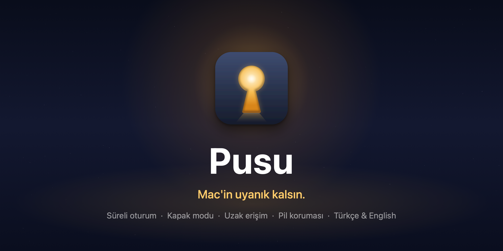
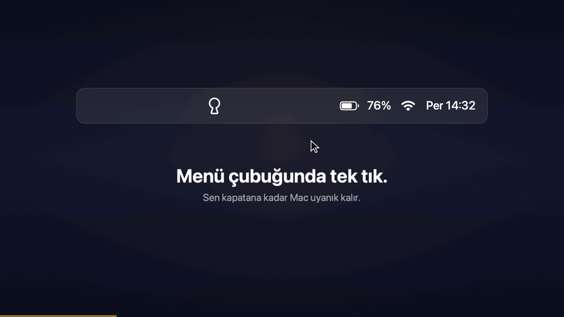
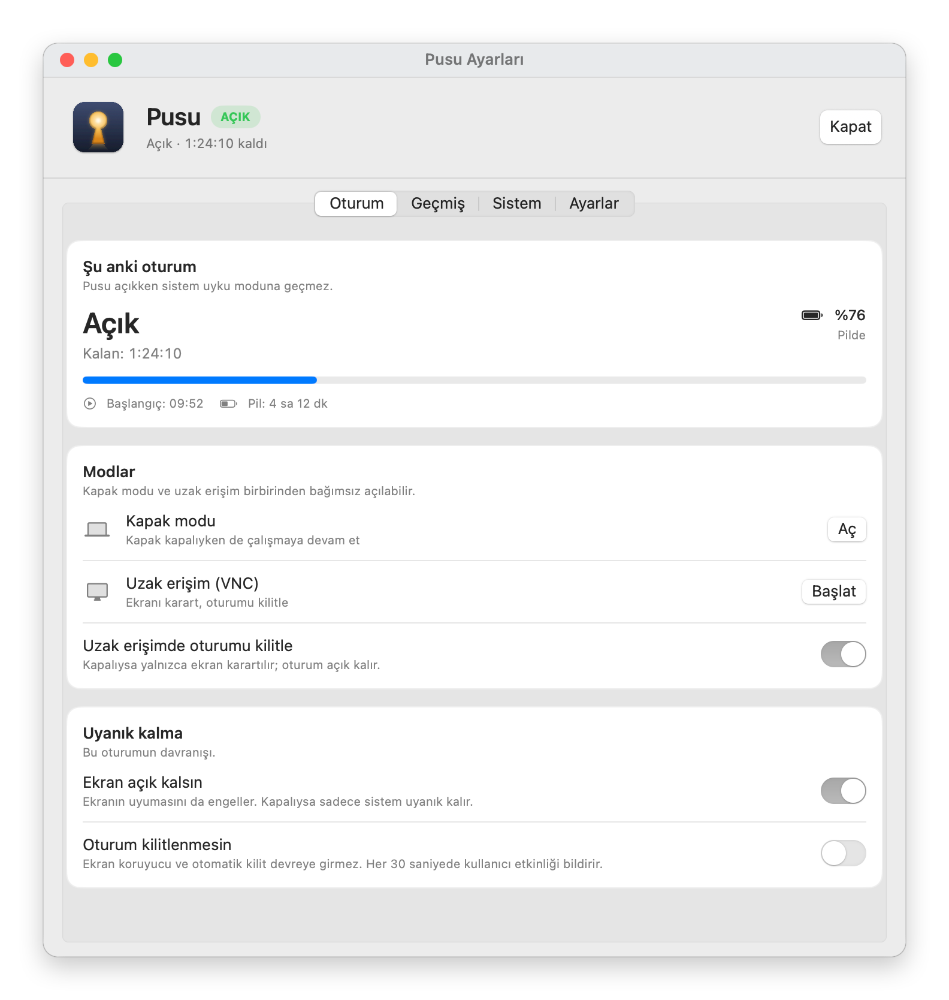
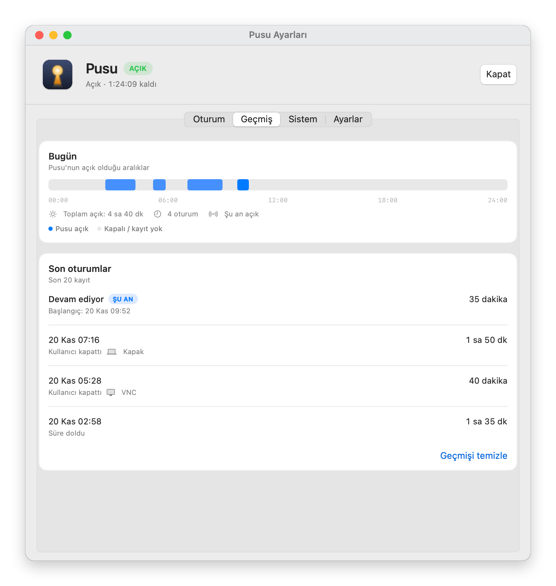

<p align="right">
  <a href="docs/README.en.md"></a>
</p>

<p align="center">
  
</p>

<p align="center">
  <a href="https://github.com/bilalkan/pusu/releases/latest"></a>
  
  
  <a href="https://github.com/bilalkan/pusu/actions/workflows/ci.yml"></a>
  <a href="LICENSE"></a>
</p>

<p align="center">
  <a href="https://github.com/bilalkan/pusu/releases/latest"><b>İndir</b></a>
  &nbsp;·&nbsp;
  <a href="#kurulum"><b>Homebrew</b></a>
  &nbsp;·&nbsp;
  <a href="docs/README.en.md"><b>English</b></a>
</p>

<br>

**Pusu**, Mac'ini uyanık tutan küçük ve yerel (native) bir menü çubuğu uygulaması. Bir saatliğine, pil azalana kadar, kapak kapalıyken ya da VNC ile bağlıyken. Anahtar deliğine tıkla, Mac uyanık kalsın.

<p align="center">
  <a href="https://github.com/bilalkan/pusu/releases/download/v1.0.0/pusu-intro-tr.mp4">
    
  </a>
  <br>
  <sub>▶ <a href="https://github.com/bilalkan/pusu/releases/download/v1.0.0/pusu-intro-tr.mp4">60 saniyelik tanıtım videosu</a> · <a href="https://github.com/bilalkan/pusu/releases/download/v1.0.0/pusu-intro-en.mp4">English</a></sub>
</p>

<p align="center">
  <picture>
    <source media="(prefers-color-scheme: dark)" srcset="docs/screenshots/session-tr-dark.png">
    
  </picture>
  <picture>
    <source media="(prefers-color-scheme: dark)" srcset="docs/screenshots/history-tr-dark.png">
    
  </picture>
</p>

## Öne çıkanlar

<table>
  <tr>
    <td width="50%" valign="top">
      <h3>⏱ İstediğin kadar</h3>
      15 dakikadan 8 saate, özel süre ya da süresiz. Menü çubuğunda canlı geri sayım, tek tıkla 15 dakika uzatma.
    </td>
    <td width="50%" valign="top">
      <h3>🔋 Pili düşünür</h3>
      Seçtiğin pil seviyesinin altında kendini kapatır. Unutulan bir oturum laptopunu tüketmez.
    </td>
  </tr>
  <tr>
    <td valign="top">
      <h3>💻 Kapak kapalı, iş sürüyor</h3>
      Kapak modu, kapak kapalıyken de Mac'in çalışmasını sağlar. İsteğe bağlı yardımcıyla parolayı her seferinde değil, bir kez girersin.
    </td>
    <td valign="top">
      <h3>🖥 Uzaktan bağlanmaya hazır</h3>
      Tek tıkla oturumu kilitler ve ekranı kapatır. Ekran Paylaşımı ya da Tern bağlanınca ekran karanlık uyanır; kapak kapalıyken sanal ekran devreye girer.
    </td>
  </tr>
  <tr>
    <td valign="top">
      <h3>🕘 Geçmiş</h3>
      Bugünün zaman çizelgesi ve son oturumlar; her birinin neden bittiği. Çökmelerde kaybolmaz.
    </td>
    <td valign="top">
      <h3>⌨️ Kısayol, komut satırı ve URL</h3>
      Her yerden <code>⌃⌥⌘A</code>, Terminal'den <code>pusu on 90</code>, Kestirmeler'den <code>pusu://on?minutes=60</code>.
    </td>
  </tr>
  <tr>
    <td valign="top">
      <h3>🌐 Türkçe ve İngilizce</h3>
      macOS dilini izler; istersen Ayarlar'dan seçersin.
    </td>
    <td valign="top">
      <h3>🔒 Gizliliğe saygılı</h3>
      Analitik yok, hesap yok. Tek ağ isteği, yalnızca sen izin verirsen günde bir kez (ya da sen bastığında) GitHub'dan son sürüm numarasını okumak. Yerel Swift, neredeyse sıfır CPU.
    </td>
  </tr>
</table>

## Kurulum

**Homebrew**

```bash
brew tap bilalkan/tap
brew trust bilalkan/tap     # Homebrew, üçüncü taraf tap'lere bir kez güvenmeni ister
brew install --cask pusu
```

**İndirme:** [Son sürümden](https://github.com/bilalkan/pusu/releases/latest) `Pusu-<sürüm>.dmg` dosyasını indir ve Pusu'yu Uygulamalar klasörüne sürükle.

> [!NOTE]
> Pusu henüz Apple tarafından onaylanmış (notarize) değil; bunun için ücretli geliştirici hesabı gerekiyor. Bu yüzden macOS, indirilen kopyanın ilk açılışını engeller. **Sistem Ayarları › Gizlilik ve Güvenlik**'te **Yine de Aç**'a tıkla ya da `xattr -dr com.apple.quarantine /Applications/Pusu.app` komutunu çalıştır. Homebrew bunu senin için yapar. Her sürüm `SHA256SUMS` ile gelir; istersen [kendin derleyebilirsin](#kaynaktan-derleme).

macOS 13 Ventura veya üstü gerekir; Apple silicon ya da Intel.

## Kullanım

Menü çubuğundaki anahtar deliğine **tıkla**: Pusu açılır ya da kapanır. **Sağ tıkla** (veya Control-tık): menü açılır; süreler, kapak modu, uzak erişim ve ayarlar oradadır. Tıklamanın menüyü açmasını istersen Ayarlar'dan değiştirebilirsin. Simge durumu bir bakışta gösterir: kapalı, uyanık, süreli (azalan halka), kapak modu ya da uzak erişim.

```bash
pusu on 90          # 90 dakika uyanık kal (ayrıca: 2h, 1h30m, 1s30d)
pusu on             # varsayılan süreyi kullan
pusu off
pusu lid on         # kapak kapalıyken çalışmaya devam et
pusu vnc            # kilitle + ekranı kapat, uzaktan bağlanmaya hazır
pusu log            # son olaylar
pusu status         # betikler için JSON
```

<details>
<summary><b>Kapak modu ve yönetici yardımcısı</b></summary>

<br>

macOS'ta kapak kapalıyken uyanık kalmanın herkese açık bir API'si yok. Bu yüzden kapak modu `pmset -a disablesleep 1` ayarını kullanır ve bu ayar yönetici yetkisi ister.

- **Yardımcı olmadan:** Pusu, kapak modunu her açıp kapattığında parola sorar.
- **Yardımcıyla** (Ayarlar › Sistem › Yardımcıyı kur…): Parolayı bir kez girersin. Pusu, tek işi `disablesleep` ayarını değiştirip geri almak olan küçük bir root servisi kurar.

Yardımcı:

- yalnızca `admin` grubunun açabildiği bir Unix soketinden dört sabit komut (`ping`, `status`, `lid-on`, `lid-off`) kabul eder; başka girdi almaz, kabuk komutu çalıştırmaz;
- orijinal `SleepDisabled` değerini saklar; kapak modu kapatıldığında, yardımcı kaldırıldığında ve durdurulduğunda geri yükler;
- Pusu kaldırılır ya da taşınırsa (uygulama yaklaşık 15 dakika ortada olmazsa) `SleepDisabled`'ı geri yükleyip kendini kaldırır; Homebrew güncellemeleri yardımcıya dokunmaz. Yardımcı yalnızca Uygulamalar klasöründeki bir Pusu için kurulabilir;
- `/Library/PrivilegedHelperTools/local.kan.pusu.helper` ve `/Library/LaunchDaemons/local.kan.pusu.helper.plist` konumlarında durur, `/var/log/local.kan.pusu.helper.log` dosyasına log yazar;
- Ayarlar › Sistem'den ya da `pusu uninstall-helper` ile kaldırılabilir.

Uyku bir şekilde kapalı kalırsa şu komut her zaman geri alır:

```bash
sudo pmset -a disablesleep 0
```

Kapak modu pildeyken daha fazla enerji harcar ve Mac ısınabilir; kapak pil korumasını açık tut.

</details>

<details>
<summary><b>Uzak erişim (VNC)</b></summary>

<br>

**Sistem Ayarları › Genel › Paylaşma › Ekran Paylaşımı**'nı aç (ya da Tern kullan), ardından **Uzak erişim (VNC) › Uzaktan bağlanmaya hazırla**'yı seç (ya da `pusu vnc`).

- **Kimse bağlı değilken:** Oturum kilitlenir, ekran uyur (M2 MacBook Air'de yaklaşık 0,7 W).
- **Ekran Paylaşımı ile bağlanınca:** Ekranı macOS kendisi uyandırır.
- **Tern ile bağlanınca:** Ekran uyanır ama Mac'in paneli ve klavye ışığı karanlık kalır; sen kilit ekranını normal görürsün (yaklaşık 2 W). 30 saniye kimse ekrana bakmazsa (yalnızca terminal) ya da Tern ayrılınca Mac yeniden kilitlenir ve ekran uyur. Pusu bunun için Tern'in kendi günlük dosyasını okur; hiçbir yere bir şey göndermez.
- **Kapak kapalıyken** (kapak modu açık): Uzak bağlantı için sanal bir ekran açılır; kilit ekranını görüp açabilirsin (yaklaşık 1 W).
- **Mac'in başına döndüğünde:** Mac'in kendi klavyesine ya da trackpad'ine dokunman (kilit ekranındayken bile) ya da kapağı açman modu bitirir ve ekranı geri getirir. Ekran parlaklığı ve klavye ışığı eski haline döner.

Başka bir uzak erişim uygulaması kullanıyorsan Ayarlar'daki **Ekranı hiç uyutma** seçeneğini aç: ekran açık ama karanlık kalır.

</details>

<details>
<summary><b>Tüm komutlar ve URL şeması</b></summary>

<br>

```text
pusu                     Menü çubuğu uygulamasını başlat
pusu on [süre]           Aç (60, 90m, 2h, 1h30m; boşsa varsayılan süre)
pusu off                 Kapat
pusu toggle              Aç/kapat
pusu status              Çalışma durumunu JSON olarak yazdır
pusu vnc                 Uzaktan bağlanmaya hazırla (ekranı kapat + isteğe bağlı kilit)
pusu lid [on|off]        Kapak modunu aç/kapat (argümansız: değiştir)
pusu blackout            Ekranı karart, kilitleme
pusu lock                Ekranı kilitle
pusu wake                Ekranı uyandır
pusu settings            Ayarlar penceresini aç
pusu diagnostics         Tanılama bilgisini yazdır
pusu log [sayı|clear]    Son olayları yazdır (son 3 gün)
pusu install-helper      Yönetici yardımcısını kur
pusu uninstall-helper    Yönetici yardımcısını kaldır
pusu version             Sürüm
```

Süreyi Türkçe kısaltmalarla da yazabilirsin: `2s` (saat), `45d` (dakika), `1s30d`. Pusu çalışmıyorsa `pusu on` onu arka planda başlatır.

URL'ler: `pusu://on`, `pusu://on?minutes=60`, `pusu://off`, `pusu://toggle`, `pusu://wake`, `pusu://settings`. Her web sayfası `pusu://` bağlantısı açabildiği için URL'ler bu zararsız komutlarla ve en fazla 8 saatlik oturumlarla sınırlı; ekranı kilitleme, karartma ve kapak modu menüde ve komut satırında kalır.

</details>

<details>
<summary><b>Güncellemeler</b></summary>

<br>

İlk açılışta Pusu güncellemeleri nasıl denetleyeceğini sorar: **günde bir kez otomatik** ya da **yalnızca sen istediğinde**. Her iki durumda da menüdeki **Güncellemeleri Denetle…** ile istediğin an bakabilirsin; Ayarlar › Ayarlar › Güncellemeler'den değiştirebilirsin.

Denetim yalnızca GitHub'ın herkese açık "son sürüm" adresini okur; çerez, kimlik ya da kullanım verisi gönderilmez. Yeni sürüm varsa menüde görünür ve bir kez bildirim gelir. Homebrew ile kurduysan `brew update && brew upgrade --cask pusu` yeterli; değilse sürüm sayfasından yeni `.dmg`'yi indir. Ayrıca GitHub'da repoyu **Watch › Custom › Releases** ile takip edebilirsin.

</details>

<details>
<summary><b>Kaldırma</b></summary>

<br>

```bash
brew uninstall --cask pusu          # uygulamayı kaldırır; yardımcı yaklaşık 15 dakika sonra kendini kaldırır
brew uninstall --zap --cask pusu    # yardımcıyı hemen kaldırır, ayarları ve geçmişi de siler
```

Homebrew kullanmadıysan bu deponun bir kopyasında `scripts/uninstall.sh` çalıştır. Uygulamayı, yardımcıyı (`SleepDisabled` geri alınır), giriş öğesini, ayarları ve geçmişi kaldırır.

</details>

<details>
<summary><b>Pusu dosyaları nerede tutar?</b></summary>

<br>

| Ne | Nerede |
|---|---|
| Ayarlar | `~/Library/Preferences/local.kan.pusu.plist` |
| Geçmiş ve durum | `~/Library/Application Support/Pusu/` |
| Giriş öğesi | `~/Library/LaunchAgents/local.kan.pusu.login.plist` |
| Yardımcı | `/Library/PrivilegedHelperTools/local.kan.pusu.helper` |

</details>

## Kaynaktan derleme

```bash
git clone https://github.com/bilalkan/pusu.git && cd pusu
swift run PusuTests     # 250'den fazla kontrol; oturum durum makinesi sahte donanımla test edilir
scripts/install.sh      # derle, /Applications'a kopyala ve `pusu` komutunu bağla
```

Yalnızca Xcode Command Line Tools (Swift 5.9+) yeterli.

<details>
<summary><b>Proje yapısı ve sürüm araçları</b></summary>

<br>

- `Sources/PusuCore`: Oturum durum makinesi, güç assertion'ları, pil, kapak, yardımcı protokolü, geçmiş, komut ayrıştırma, dil.
- `Sources/Pusu`: Menü çubuğu uygulaması (AppKit + SwiftUI) ve `pusu` komutu.
- `Sources/PusuHelper`: Root yardımcısı.
- `Tests/PusuCoreTests`: Test koşucusu (XCTest gerektirmez, yalnızca Command Line Tools ile çalışır).

Arayüz metinleri kodda `L("Türkçe", "English")` biçiminde yan yana yazılır; hiçbir metin çevrilmeden yayına çıkamaz.

- `scripts/package.sh`, `dist/` içinde universal `.zip` ve `.dmg` üretir. Apple Developer ID'n varsa imzalama ve notarization için `PUSU_SIGN_IDENTITY` ve `PUSU_NOTARY_PROFILE` değişkenlerini ayarla.
- `scripts/cask.sh`, mevcut sürüm için Homebrew cask dosyasını yazdırır.
- `swift run Pusu --snapshot-ui build/snapshots` (debug derlemesi), Ayarlar'ın tüm sekmelerini iki dilde ve iki temada, ekran kaydı izni olmadan üretir.

</details>

## Lisans

[GPL-3.0](LICENSE). Kullan, incele, değiştir, paylaş. Pusu üzerine kurup dağıttığın her şey de GPL altında açık kalmalı.
