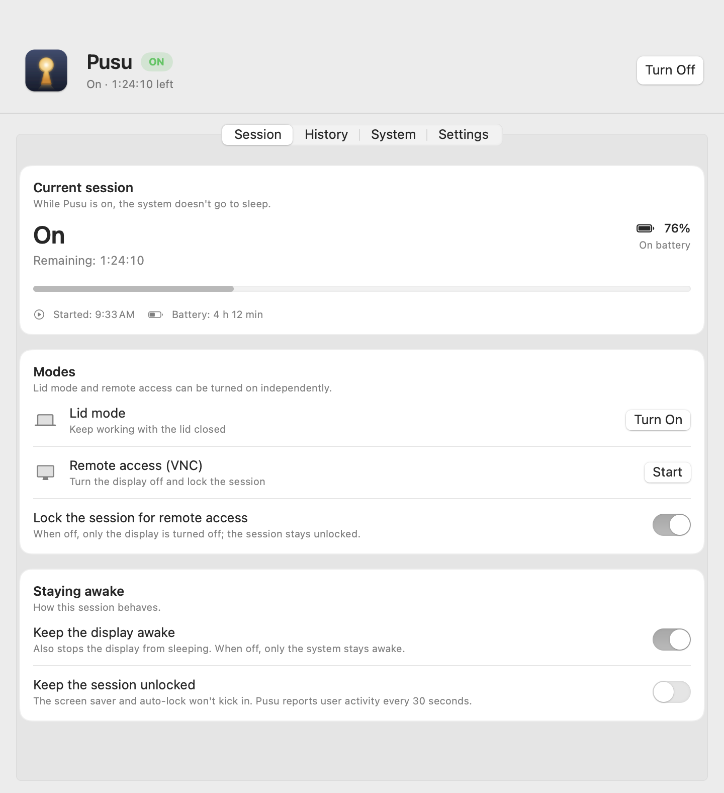
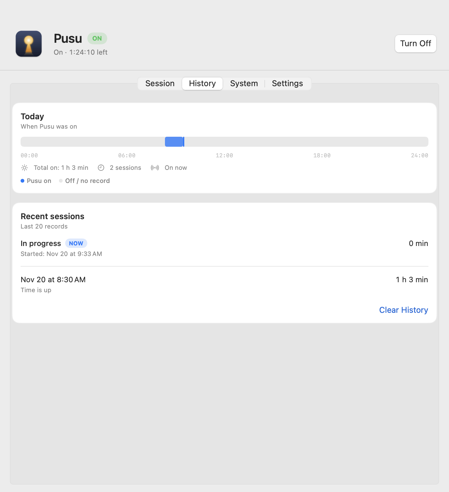

# Pusu

**Keeps your Mac awake — on a timer, with the lid closed, or ready for remote access.**

[Türkçe](README.tr.md) · [Download](https://github.com/bilalkan/pusu/releases/latest) · [Report a bug](https://github.com/bilalkan/pusu/issues)

Pusu (*POO-soo*, Turkish for "lying in wait") is a small native menu bar app for macOS. It stops the system and display from sleeping, turns itself off when the time is up or the battery runs low, can keep the Mac running with the lid closed, and can turn the display off and lock the session while you connect over VNC.

<p align="center">
  
  
</p>

## Features

- **Stay awake** — prevents idle system sleep, and optionally display sleep (IOKit power assertions).
- **Timers** — 15 min to 8 hours, a custom duration, or indefinitely. Countdown in the menu bar; extend by 15 minutes.
- **Battery guard** — turns off below a battery level you choose (5–25%).
- **Lid mode** — keeps the Mac awake with the lid closed (`pmset disablesleep`). Turns itself off on battery below a separate threshold.
- **Remote access (VNC)** — keeps the system awake, turns the display off and (optionally) locks the session, so the Mac is ready for Screen Sharing.
- **Keep the session unlocked** — stops the screen saver and auto-lock from kicking in.
- **History** — today's timeline and your last sessions, with why each one ended. Survives crashes.
- **Global shortcut** — `⌃⌥⌘A` by default.
- **Command line and URL scheme** — `pusu on 90`, `pusu off`, `pusu://on?minutes=60`.
- **Turkish and English** — follows your macOS language, or pick one in Settings.
- **Private** — no network access, no analytics. Everything stays on your Mac.

Requires macOS 13 Ventura or later. Universal: Apple silicon and Intel.

## Install

### Homebrew

```bash
brew install --cask bilalkan/tap/pusu
```

This also installs the `pusu` command.

### Download

Download `Pusu-<version>.dmg` from the [latest release](https://github.com/bilalkan/pusu/releases/latest) and drag Pusu to Applications.

**First launch:** Pusu isn't notarized by Apple yet (that needs a paid developer account), so macOS will refuse to open it the first time. To allow it:

1. Try to open Pusu once, then click **Done**.
2. Open **System Settings › Privacy & Security**, scroll down and click **Open Anyway** next to Pusu.

Or, in Terminal:

```bash
xattr -dr com.apple.quarantine /Applications/Pusu.app
```

The Homebrew cask does this for you. You can check every release against `SHA256SUMS`, or build it yourself (see below).

### From source

```bash
git clone https://github.com/bilalkan/pusu.git
cd pusu
make test      # run the test suite
make install   # build, copy to /Applications and link the `pusu` command
```

Needs the Xcode Command Line Tools (Swift 5.9 or later).

## Usage

Click the keyhole icon in the menu bar. The icon shows the state: off, awake, on a timer (a ring that drains), lid mode, or remote access mode.

### Lid mode and the helper

macOS has no public API to stay awake with the lid closed, so lid mode sets `pmset -a disablesleep 1` — that needs administrator rights.

- **Without the helper**, Pusu asks for your password each time you turn lid mode on or off.
- **With the helper** (Settings › System › Install Helper…), you enter your password once. Pusu installs a tiny root daemon that does exactly one thing: set and restore `disablesleep`.

About the helper:

- It accepts four fixed commands (`ping`, `status`, `lid-on`, `lid-off`) over a Unix socket that only the `admin` group can open. It takes no other input and runs no shell commands.
- It remembers the original `SleepDisabled` value and puts it back when lid mode is turned off, when the helper is removed, or when it is stopped.
- Files: `/Library/PrivilegedHelperTools/local.kan.pusu.helper`, `/Library/LaunchDaemons/local.kan.pusu.helper.plist`, log at `/var/log/local.kan.pusu.helper.log`.
- Remove it from Settings › System, or with `pusu uninstall-helper`.

If sleep ever stays disabled, this always undoes it:

```bash
sudo pmset -a disablesleep 0
```

Lid mode on battery uses more power and can get warm. Keep the lid battery guard on.

### Remote access (VNC)

Turn on **System Settings › General › Sharing › Screen Sharing**, then choose **Remote Access (VNC) › Prepare for Remote Connection**. Pusu keeps the system awake, turns the display off and, if you want, locks the session. Connect, and choose **Wake Display** (or `pusu wake`) when you're back.

### Command line

```text
pusu                     Launch the menu bar app
pusu on [duration]       Turn on (60, 90m, 2h, 1h30m; default duration if empty)
pusu off                 Turn off
pusu toggle              Toggle on/off
pusu status              Print the runtime state as JSON
pusu vnc                 Prepare for remote access (blackout + optional lock)
pusu lid [on|off]        Turn lid mode on/off (no argument: toggle)
pusu blackout            Turn the display off without locking
pusu lock                Lock the screen
pusu wake                Wake the display
pusu settings            Open the Settings window
pusu diagnostics         Print diagnostics
pusu install-helper      Install the privileged helper
pusu uninstall-helper    Remove the privileged helper
pusu version             Print the version
```

If Pusu isn't running, `pusu on` starts it in the background.

### URL scheme

`pusu://on`, `pusu://on?minutes=60`, `pusu://off`, `pusu://toggle`, `pusu://vnc`, `pusu://blackout`, `pusu://lock`, `pusu://wake`, `pusu://settings` — handy for Shortcuts and other automation.

## Uninstall

With Homebrew:

```bash
brew uninstall --cask pusu          # removes the app and the helper
brew uninstall --zap --cask pusu    # also removes settings and history
```

Otherwise, from a clone of this repository:

```bash
scripts/uninstall.sh
```

It removes the app, the helper (restoring `SleepDisabled`), the login item, settings and history.

## Files

| What | Where |
|---|---|
| Settings | `~/Library/Preferences/local.kan.pusu.plist` |
| History and state | `~/Library/Application Support/Pusu/` |
| Login item | `~/Library/LaunchAgents/local.kan.pusu.login.plist` |
| Helper | `/Library/PrivilegedHelperTools/local.kan.pusu.helper` |

## Development

```bash
make test        # 200+ checks, including the session state machine with fake hardware
make debug       # debug build in build/Pusu.app
make package     # universal release .zip and .dmg in dist/
```

- `Sources/PusuCore` — session state machine, power assertions, battery, lid, helper protocol, history, command parsing, localization.
- `Sources/Pusu` — the menu bar app (AppKit + SwiftUI) and the `pusu` command.
- `Sources/PusuHelper` — the root helper.
- `Tests/PusuCoreTests` — test runner (no XCTest needed, so it works with just the Command Line Tools).

UI text is written in place as `L("Türkçe", "English")`, so a string can't ship untranslated.

Debug builds can render every Settings tab in both languages without screen-recording permission:

```bash
swift run Pusu --snapshot-ui build/snapshots
```

Releases are built with `scripts/package.sh`. With an Apple Developer ID, set `PUSU_SIGN_IDENTITY` and `PUSU_NOTARY_PROFILE` to sign and notarize.

## License

[GPL-3.0](LICENSE). You may use, study, change and share Pusu; anything you distribute that's built on it must also be released under the GPL with its source code.
