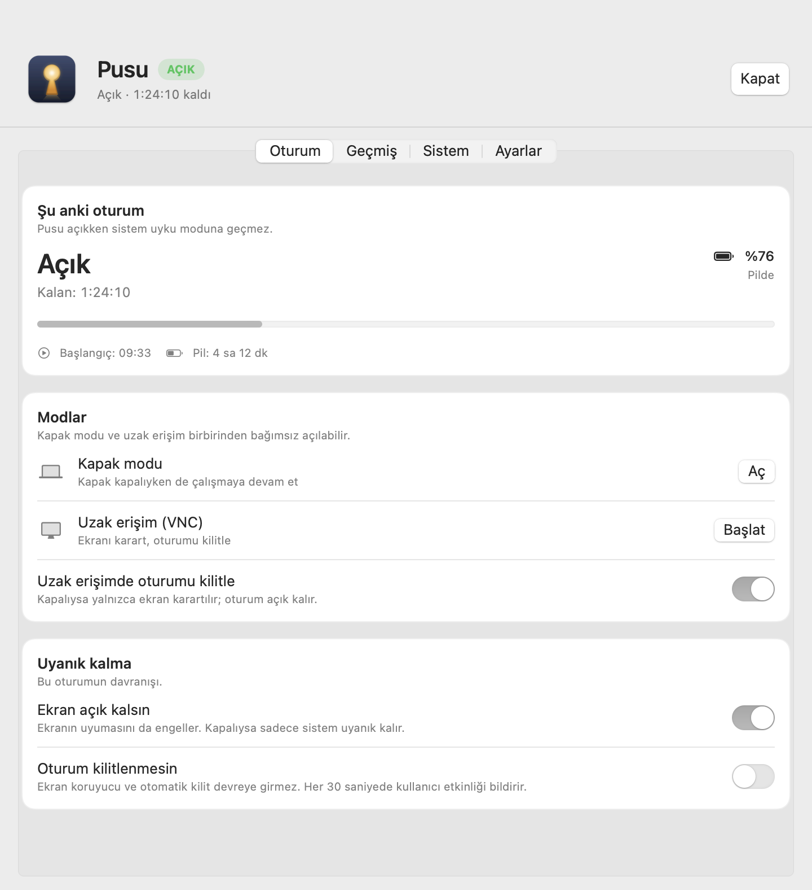
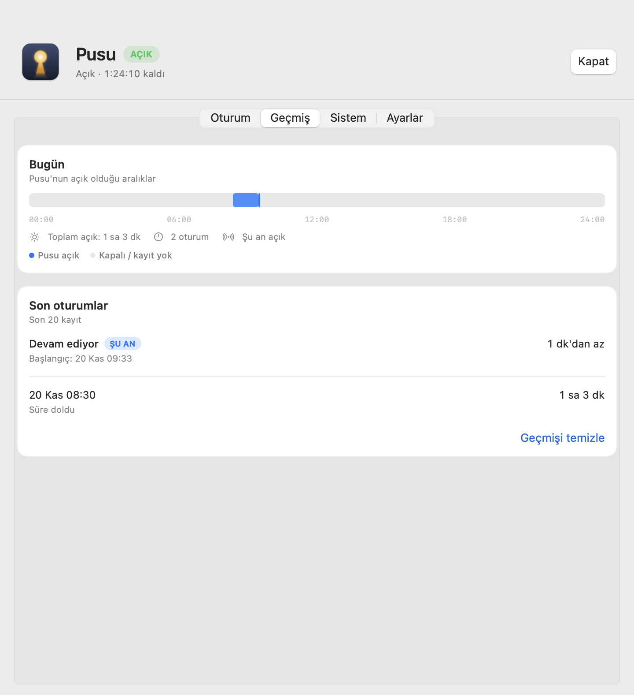

# Pusu

**Mac'ini uyanık tutar: süreli, kapak kapalıyken ya da uzaktan bağlanmaya hazır.**

[English](README.md) · [İndir](https://github.com/bilalkan/pusu/releases/latest) · [Hata bildir](https://github.com/bilalkan/pusu/issues)

Pusu, macOS için küçük ve yerel (native) bir menü çubuğu uygulamasıdır. Sistemin ve ekranın uykuya geçmesini engeller. Süre dolunca ya da pil azalınca kendini kapatır. Kapak kapalıyken de Mac'in çalışmaya devam etmesini sağlayabilir. VNC ile bağlanırken ekranı karartıp oturumu kilitleyebilir.

<p align="center">
  
  
</p>

## Özellikler

- **Uyanık kalma:** Sistemin boştayken uyumasını, istersen ekranın uyumasını da engeller (IOKit power assertion).
- **Süre:** 15 dakikadan 8 saate kadar hazır süreler, özel süre ya da süresiz. Menü çubuğunda geri sayım; 15 dakika uzatma.
- **Pil koruması:** Seçtiğin pil seviyesinin (%5–25) altında kendini kapatır.
- **Kapak modu:** Kapak kapalıyken Mac uyanık kalır (`pmset disablesleep`). Pildeyken ayrı bir eşiğin altında kendini kapatır.
- **Uzak erişim (VNC):** Sistemi uyanık tutar, ekranı karartır ve istersen oturumu kilitler. Mac, Ekran Paylaşımı ile bağlanmaya hazır olur.
- **Oturum kilitlenmesin:** Ekran koruyucu ve otomatik kilit devreye girmez.
- **Geçmiş:** Bugünün zaman çizelgesi ve son oturumlar; her birinin neden bittiği. Uygulama çökse de kaybolmaz.
- **Global kısayol:** Varsayılan `⌃⌥⌘A`.
- **Komut satırı ve URL şeması:** `pusu on 90`, `pusu off`, `pusu://on?minutes=60`.
- **Türkçe ve İngilizce:** macOS dilini izler; istersen Ayarlar'dan seçebilirsin.
- **Gizlilik:** Ağ bağlantısı kurmaz, analitik toplamaz. Her şey Mac'inde kalır.

macOS 13 Ventura veya üstü gerekir. Universal: Apple silicon ve Intel.

## Kurulum

### Homebrew

```bash
brew install --cask bilalkan/tap/pusu
```

Bu komut `pusu` komut satırı aracını da kurar.

### İndirme

[Son sürümden](https://github.com/bilalkan/pusu/releases/latest) `Pusu-<sürüm>.dmg` dosyasını indir ve Pusu'yu Uygulamalar klasörüne sürükle.

**İlk açılış:** Pusu henüz Apple tarafından onaylanmış (notarize) değil; bunun için ücretli geliştirici hesabı gerekiyor. Bu yüzden macOS ilk seferde açmayı reddeder. İzin vermek için:

1. Pusu'yu bir kez açmayı dene, ardından **Bitti**'ye tıkla.
2. **Sistem Ayarları › Gizlilik ve Güvenlik**'i aç, aşağı kaydır ve Pusu'nun yanındaki **Yine de Aç**'a tıkla.

Ya da Terminal'de:

```bash
xattr -dr com.apple.quarantine /Applications/Pusu.app
```

Homebrew ile kurduysan bu adım otomatik yapılır. Her sürümü `SHA256SUMS` ile doğrulayabilir ya da kendin derleyebilirsin (aşağıda).

### Kaynaktan

```bash
git clone https://github.com/bilalkan/pusu.git
cd pusu
make test      # testleri çalıştır
make install   # derle, /Applications'a kopyala ve `pusu` komutunu bağla
```

Xcode Command Line Tools (Swift 5.9 veya üstü) yeterlidir.

## Kullanım

Menü çubuğundaki anahtar deliği simgesine tıkla. Simge durumu gösterir: kapalı, uyanık, süreli (azalan halka), kapak modu ya da uzak erişim modu.

### Kapak modu ve yardımcı

macOS'ta kapak kapalıyken uyanık kalmanın herkese açık bir API'si yok. Bu yüzden kapak modu `pmset -a disablesleep 1` ayarını kullanır ve bu ayar yönetici yetkisi ister.

- **Yardımcı olmadan:** Pusu, kapak modunu her açıp kapattığında parola sorar.
- **Yardımcıyla** (Ayarlar › Sistem › Yardımcıyı kur…): Parolayı bir kez girersin. Pusu, tek işi `disablesleep` ayarını değiştirip geri almak olan küçük bir root servisi kurar.

Yardımcı hakkında:

- Yalnızca `admin` grubunun açabildiği bir Unix soketinden dört sabit komut kabul eder: `ping`, `status`, `lid-on`, `lid-off`. Başka girdi almaz, kabuk komutu çalıştırmaz.
- Orijinal `SleepDisabled` değerini saklar. Kapak modu kapatıldığında, yardımcı kaldırıldığında ya da durdurulduğunda bu değeri geri yükler.
- Dosyalar: `/Library/PrivilegedHelperTools/local.kan.pusu.helper`, `/Library/LaunchDaemons/local.kan.pusu.helper.plist`. Log: `/var/log/local.kan.pusu.helper.log`.
- Kaldırmak için: Ayarlar › Sistem ya da `pusu uninstall-helper`.

Uyku bir şekilde kapalı kalırsa şu komut her zaman geri alır:

```bash
sudo pmset -a disablesleep 0
```

Kapak modu pildeyken daha fazla enerji harcar ve Mac ısınabilir. Kapak pil korumasını açık tut.

### Uzak erişim (VNC)

**Sistem Ayarları › Genel › Paylaşma › Ekran Paylaşımı**'nı aç, ardından **Uzak erişim (VNC) › Uzaktan bağlanmaya hazırla**'yı seç. Pusu sistemi uyanık tutar, ekranı karartır ve istersen oturumu kilitler. Bağlan; işin bitince **Ekranı uyandır**'ı seç ya da `pusu wake` komutunu kullan.

### Komut satırı

```text
pusu                     Menü çubuğu uygulamasını başlat
pusu on [süre]           Aç (60, 90m, 2h, 1h30m; boşsa varsayılan süre)
pusu off                 Kapat
pusu toggle              Aç/kapat
pusu status              Çalışma durumunu JSON olarak yazdır
pusu vnc                 Uzaktan bağlanmaya hazırla (karart + isteğe bağlı kilit)
pusu lid [on|off]        Kapak modunu aç/kapat (argümansız: değiştir)
pusu blackout            Ekranı karart, kilitleme
pusu lock                Ekranı kilitle
pusu wake                Ekranı uyandır
pusu settings            Ayarlar penceresini aç
pusu diagnostics         Tanılama bilgisini yazdır
pusu install-helper      Yönetici yardımcısını kur
pusu uninstall-helper    Yönetici yardımcısını kaldır
pusu version             Sürüm
```

Süreyi Türkçe kısaltmalarla da yazabilirsin: `2s` (saat), `45d` (dakika), `1s30d`. Pusu çalışmıyorsa `pusu on` onu arka planda başlatır.

### URL şeması

`pusu://on`, `pusu://on?minutes=60`, `pusu://off`, `pusu://toggle`, `pusu://vnc`, `pusu://blackout`, `pusu://lock`, `pusu://wake`, `pusu://settings`. Kestirmeler (Shortcuts) ve diğer otomasyonlar için kullanışlıdır.

## Kaldırma

Homebrew ile:

```bash
brew uninstall --cask pusu          # uygulamayı ve yardımcıyı kaldırır
brew uninstall --zap --cask pusu    # ayarları ve geçmişi de siler
```

Homebrew kullanmadıysan, bu deponun bir kopyasında:

```bash
scripts/uninstall.sh
```

Bu script uygulamayı, yardımcıyı (`SleepDisabled` geri alınır), giriş öğesini, ayarları ve geçmişi kaldırır.

## Dosyalar

| Ne | Nerede |
|---|---|
| Ayarlar | `~/Library/Preferences/local.kan.pusu.plist` |
| Geçmiş ve durum | `~/Library/Application Support/Pusu/` |
| Giriş öğesi | `~/Library/LaunchAgents/local.kan.pusu.login.plist` |
| Yardımcı | `/Library/PrivilegedHelperTools/local.kan.pusu.helper` |

## Geliştirme

```bash
make test        # 200'den fazla kontrol; oturum durum makinesi sahte donanımla test edilir
make debug       # build/Pusu.app içinde debug derlemesi
make package     # dist/ içinde universal .zip ve .dmg
```

- `Sources/PusuCore`: Oturum durum makinesi, güç assertion'ları, pil, kapak, yardımcı protokolü, geçmiş, komut ayrıştırma, dil.
- `Sources/Pusu`: Menü çubuğu uygulaması (AppKit + SwiftUI) ve `pusu` komutu.
- `Sources/PusuHelper`: Root yardımcısı.
- `Tests/PusuCoreTests`: Test koşucusu. XCTest gerektirmez, yalnızca Command Line Tools ile çalışır.

Arayüz metinleri kodda `L("Türkçe", "English")` biçiminde yan yana yazılır. Böylece hiçbir metin çevrilmeden yayına çıkamaz.

Debug derlemesi, ekran kaydı izni olmadan Ayarlar'ın tüm sekmelerini iki dilde PNG olarak üretebilir:

```bash
swift run Pusu --snapshot-ui build/snapshots
```

Sürümler `scripts/package.sh` ile üretilir. Apple Developer ID'n varsa, imzalama ve notarization için `PUSU_SIGN_IDENTITY` ve `PUSU_NOTARY_PROFILE` değişkenlerini ayarla.

## Lisans

[GPL-3.0](LICENSE). Pusu'yu kullanabilir, inceleyebilir, değiştirebilir ve paylaşabilirsin. Pusu'dan türetip dağıttığın her şey de kaynak koduyla birlikte GPL altında yayınlanmalıdır.
