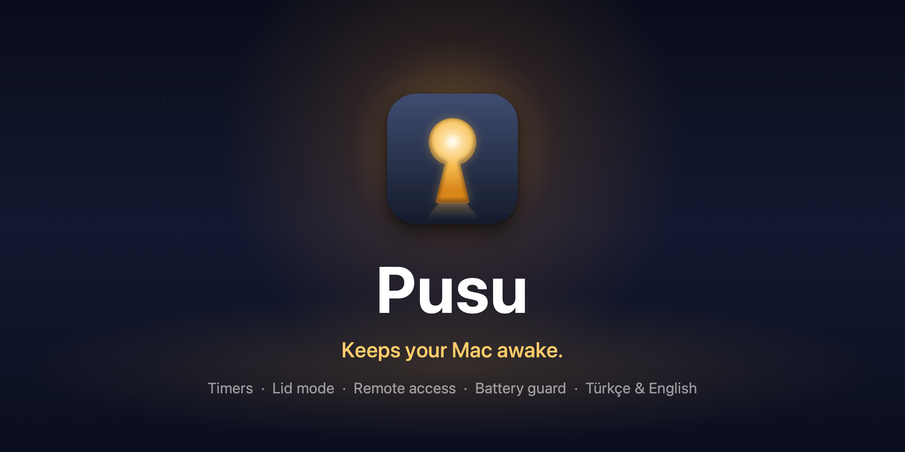
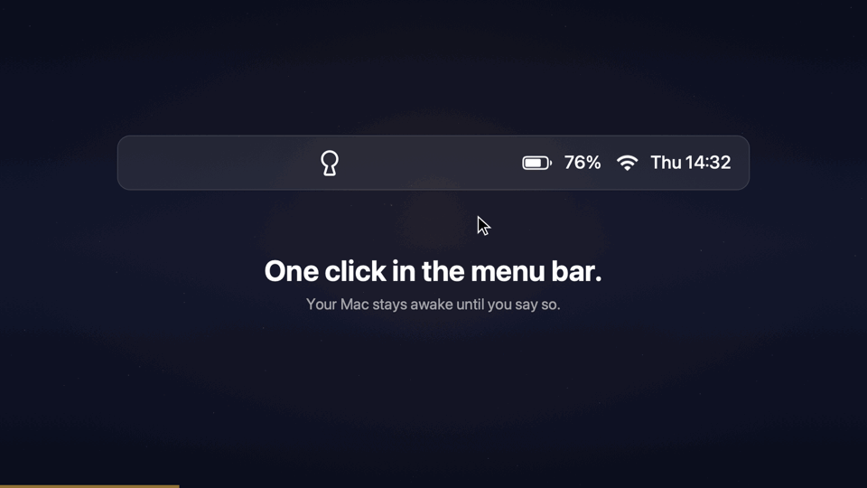
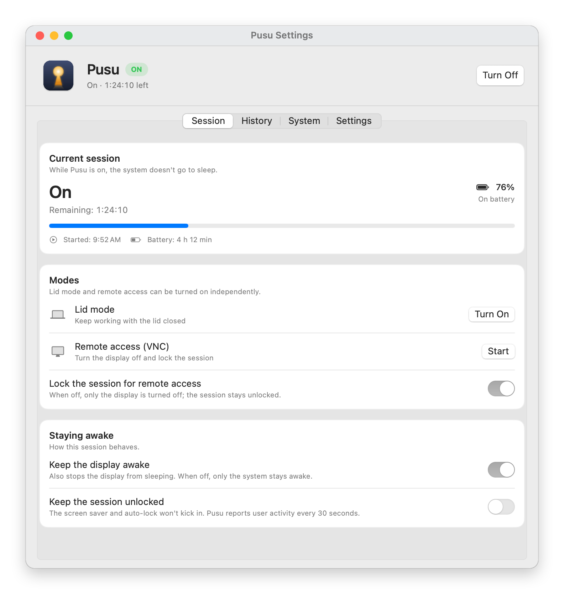
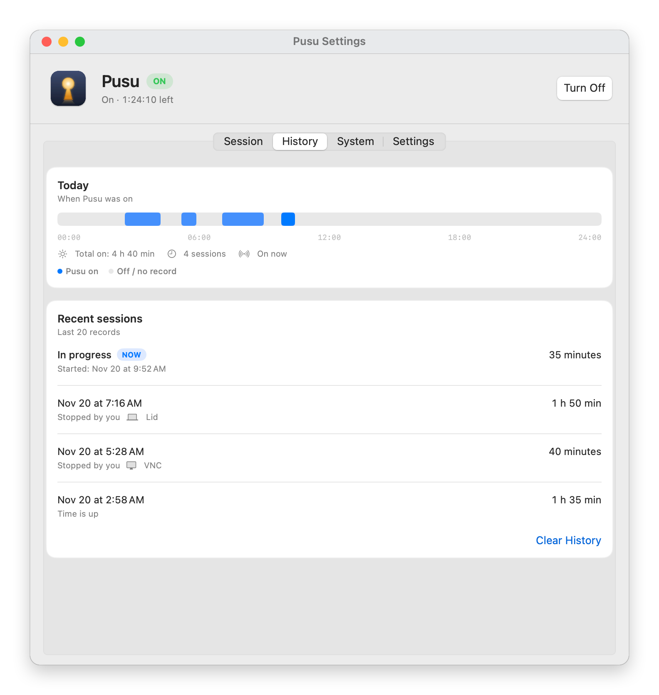

<p align="right">
  <a href="../README.md"></a>
</p>

<p align="center">
  
</p>

<p align="center">
  <a href="https://github.com/bilalkan/pusu/releases/latest"></a>
  
  
  <a href="https://github.com/bilalkan/pusu/actions/workflows/ci.yml"></a>
  <a href="../LICENSE"></a>
</p>

<p align="center">
  <a href="https://github.com/bilalkan/pusu/releases/latest"><b>Download</b></a>
  &nbsp;·&nbsp;
  <a href="#install"><b>Homebrew</b></a>
  &nbsp;·&nbsp;
  <a href="../README.md"><b>Türkçe</b></a>
</p>

<br>

**Pusu** (*POO-soo*, Turkish for "lying in wait") is a small, native menu bar app that keeps your Mac awake: for an hour, until the battery runs low, with the lid closed, or while you're connected over VNC. Click the keyhole, and it stays up.

<p align="center">
  <a href="https://github.com/bilalkan/pusu/releases/download/v1.0.0/pusu-intro-en.mp4">
    
  </a>
  <br>
  <sub>▶ <a href="https://github.com/bilalkan/pusu/releases/download/v1.0.0/pusu-intro-en.mp4">Watch the 60-second intro</a> · <a href="https://github.com/bilalkan/pusu/releases/download/v1.0.0/pusu-intro-tr.mp4">Türkçe</a></sub>
</p>

<p align="center">
  <picture>
    <source media="(prefers-color-scheme: dark)" srcset="screenshots/session-en-dark.png">
    
  </picture>
  <picture>
    <source media="(prefers-color-scheme: dark)" srcset="screenshots/history-en-dark.png">
    
  </picture>
</p>

## Highlights

<table>
  <tr>
    <td width="50%" valign="top">
      <h3>⏱ On your schedule</h3>
      15 minutes to 8 hours, a custom duration, or indefinitely. A live countdown in the menu bar, and one click to add 15 minutes.
    </td>
    <td width="50%" valign="top">
      <h3>🔋 Battery-aware</h3>
      Turns itself off below the battery level you choose, so a forgotten session never drains your laptop.
    </td>
  </tr>
  <tr>
    <td valign="top">
      <h3>💻 Lid closed, still working</h3>
      Lid mode keeps the Mac running with the lid shut. An optional helper means you type your password once, not every time.
    </td>
    <td valign="top">
      <h3>🖥 Ready for remote access</h3>
      One click keeps the system awake, turns the display off and locks the session, ready for Screen Sharing / VNC.
    </td>
  </tr>
  <tr>
    <td valign="top">
      <h3>🕘 History</h3>
      Today's timeline and your recent sessions, with why each one ended. Survives crashes.
    </td>
    <td valign="top">
      <h3>⌨️ Shortcut, CLI and URLs</h3>
      <code>⌃⌥⌘A</code> from anywhere, <code>pusu on 90</code> in Terminal, <code>pusu://on?minutes=60</code> from Shortcuts.
    </td>
  </tr>
  <tr>
    <td valign="top">
      <h3>🌐 Turkish and English</h3>
      Follows your macOS language, or pick one in Settings.
    </td>
    <td valign="top">
      <h3>🔒 Private by design</h3>
      No network access, no analytics, no account. Native Swift, near-zero CPU.
    </td>
  </tr>
</table>

## Install

**Homebrew**

```bash
brew tap bilalkan/tap
brew trust bilalkan/tap     # Homebrew asks you to trust third-party taps once
brew install --cask pusu
```

**Download:** grab `Pusu-<version>.dmg` from the [latest release](https://github.com/bilalkan/pusu/releases/latest) and drag Pusu to Applications.

> [!NOTE]
> Pusu isn't notarized by Apple yet (that needs a paid developer account), so macOS blocks the first launch of a downloaded copy. Open **System Settings › Privacy & Security** and click **Open Anyway**, or run `xattr -dr com.apple.quarantine /Applications/Pusu.app`. Homebrew does this for you. Every release ships with `SHA256SUMS`, and you can always [build it yourself](#build-from-source).

Requires macOS 13 Ventura or later, on Apple silicon or Intel.

## Using Pusu

Click the keyhole in the menu bar. The icon tells you the state at a glance: off, awake, on a timer (a ring that drains), lid mode, or remote access.

```bash
pusu on 90          # stay awake for 90 minutes (also: 2h, 1h30m)
pusu on             # use your default duration
pusu off
pusu lid on         # keep running with the lid closed
pusu vnc            # display off + lock, ready for Screen Sharing
pusu status         # JSON, for scripts
```

<details>
<summary><b>Lid mode and the privileged helper</b></summary>

<br>

macOS has no public API to stay awake with the lid closed, so lid mode sets `pmset -a disablesleep 1`, which needs administrator rights.

- **Without the helper**, Pusu asks for your password each time you turn lid mode on or off.
- **With the helper** (Settings › System › Install Helper…), you enter it once. Pusu installs a tiny root daemon whose only job is to set and restore `disablesleep`.

The helper:

- accepts four fixed commands (`ping`, `status`, `lid-on`, `lid-off`) over a Unix socket only the `admin` group can open, takes no other input and runs no shell commands;
- remembers the original `SleepDisabled` value and puts it back when lid mode is turned off, when the helper is removed, and when it's stopped;
- lives at `/Library/PrivilegedHelperTools/local.kan.pusu.helper` with `/Library/LaunchDaemons/local.kan.pusu.helper.plist`, logging to `/var/log/local.kan.pusu.helper.log`;
- can be removed from Settings › System or with `pusu uninstall-helper`.

If sleep ever stays disabled, this always undoes it:

```bash
sudo pmset -a disablesleep 0
```

Lid mode on battery uses more power and can get warm, so keep the lid battery guard on.

</details>

<details>
<summary><b>Remote access (VNC)</b></summary>

<br>

Turn on **System Settings › General › Sharing › Screen Sharing**, then choose **Remote Access (VNC) › Prepare for Remote Connection** (or run `pusu vnc`). Pusu keeps the system awake, turns the display off and, if you like, locks the session. Connect, and choose **Wake Display** (or `pusu wake`) when you're back. The display stays dark while you're away; Pusu doesn't nudge it awake.

</details>

<details>
<summary><b>All commands and the URL scheme</b></summary>

<br>

```text
pusu                     Launch the menu bar app
pusu on [duration]       Turn on (60, 90m, 2h, 1h30m; default duration if empty)
pusu off                 Turn off
pusu toggle              Toggle on/off
pusu status              Print the runtime state as JSON
pusu vnc                 Prepare for remote access (blackout + optional lock)
pusu lid [on|off]        Turn lid mode on/off (no argument: toggle)
pusu blackout            Turn the display off without locking
pusu lock                Lock the screen
pusu wake                Wake the display
pusu settings            Open the Settings window
pusu diagnostics         Print diagnostics
pusu install-helper      Install the privileged helper
pusu uninstall-helper    Remove the privileged helper
pusu version             Print the version
```

If Pusu isn't running, `pusu on` starts it in the background.

URLs: `pusu://on`, `pusu://on?minutes=60`, `pusu://off`, `pusu://toggle`, `pusu://wake`, `pusu://settings`. Since any web page can open a `pusu://` link, URLs are limited to these harmless commands and to sessions of at most 8 hours; locking the screen, turning the display off and lid mode stay in the menu and the CLI.

</details>

<details>
<summary><b>Uninstall</b></summary>

<br>

```bash
brew uninstall --cask pusu          # removes the app and the helper
brew uninstall --zap --cask pusu    # also removes settings and history
```

Without Homebrew, run `scripts/uninstall.sh` from a clone of this repository. It removes the app, the helper (restoring `SleepDisabled`), the login item, settings and history.

</details>

<details>
<summary><b>Where Pusu keeps things</b></summary>

<br>

| What | Where |
|---|---|
| Settings | `~/Library/Preferences/local.kan.pusu.plist` |
| History and state | `~/Library/Application Support/Pusu/` |
| Login item | `~/Library/LaunchAgents/local.kan.pusu.login.plist` |
| Helper | `/Library/PrivilegedHelperTools/local.kan.pusu.helper` |

</details>

## Build from source

```bash
git clone https://github.com/bilalkan/pusu.git && cd pusu
swift run PusuTests     # 250+ checks, including the session state machine with fake hardware
scripts/install.sh      # build, copy to /Applications and link the `pusu` command
```

You only need the Xcode Command Line Tools (Swift 5.9+).

<details>
<summary><b>Project layout and release tooling</b></summary>

<br>

- `Sources/PusuCore`: session state machine, power assertions, battery, lid, helper protocol, history, command parsing, localization.
- `Sources/Pusu`: the menu bar app (AppKit + SwiftUI) and the `pusu` command.
- `Sources/PusuHelper`: the root helper.
- `Tests/PusuCoreTests`: the test runner (no XCTest, so it works with just the Command Line Tools).

UI text is written in place as `L("Türkçe", "English")`, so a string can't ship untranslated.

- `scripts/package.sh` builds a universal `.zip` and `.dmg` in `dist/`. With an Apple Developer ID, set `PUSU_SIGN_IDENTITY` and `PUSU_NOTARY_PROFILE` to sign and notarize.
- `scripts/cask.sh` prints the Homebrew cask for the current release.
- `swift run Pusu --snapshot-ui build/snapshots` (debug builds) renders every Settings tab in both languages and themes, without screen-recording permission.

</details>

## License

[GPL-3.0](../LICENSE). Use it, study it, change it, share it. If you distribute something built on Pusu, it has to stay open under the GPL too.
